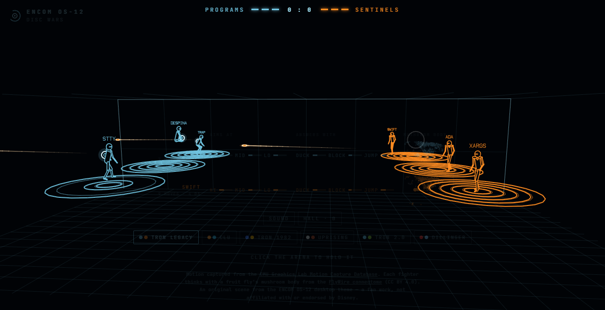

# ENCOM Disc Wars

Programs duel with identity discs on rings floating above an arena floor —
one on one, or two ranks of three. It runs in a browser, on a canvas, in any
of six colour schemes.

**[Watch it →](https://robertmcortese.github.io/encom-disc-wars/)**



## Matches

Every match is **three against three**: two ranks of platforms facing each
other across the arena, every fighter on its own rings. Three exchanges run at
once, so three discs are in the air; fighters mostly stay on the opponent they
are fighting, gang up on one left hanging from an edge, and now and then
switch. A broken ring rises again on its own after a while, so a match left
running never wears every platform away. The camera drifts toward the action.

A scoreboard across the top carries each side's name, a pip per fighter that
goes dark as it is knocked out, and the rounds won, with the winning side
named beneath when a round ends.

Once a teammate is out its platform stands empty, and the survivors can dodge
**across onto it**: a longer, higher jump to the next platform along the rank,
never onto the other side's and never onto one somebody is already standing
on. The rank thins out and spreads as the round wears on.

A fighter that goes over the edge is **out for the round**. Nobody comes back
until one side has been cleared off the board entirely; then every ring rises,
both teams rez in and the next round begins. A match is a war of
attrition — three a side worn down to one, and now and then a clean sweep.

## The Hall of Champions

Every fighter ever crowned is kept in the **Hall**, in this browser, so the
stable is still there after you close the tab and come back. A champion's
entry is its name, rank, record, named moves and its fly's learned weights
(about 17 KB), and it is brought up to date after every round it is part of
and the moment it falls. The **Hall** chip at the top of the page shows how
many there are and opens the list, most decorated first.

Tick a champion to field it and choose its side with the radio buttons;
**Start Match** sets the match up from the ticks, up to three a side. Every
seat nobody was picked for is filled with a new program, so a Hall match is
three against three like any other.

In a Hall match every champion picked keeps its seat for every round,
fallen or not, rezzing with its fly and moves as they now stand; a round won
while still standing counts toward its rank, as anywhere, and is saved back
to the Hall. New programs filling an empty side are replaced each round with
new flies, and nobody new is crowned. **Back to new programs**, in the Hall
while a Hall match is on, goes back to ordinary matches.

The Hall keeps the 120 most decorated; past that, or past what the browser
will store, the least decorated make room.

## The fight plays itself

Turn Sound on and the arena plays a track. A four-on-the-floor kick with a
snare on two and four holds **120 BPM**, an open hat hisses on every
off-beat, and a bassline walks the root. The chords move every two bars in
D# minor, and the bass moves with them.

**Every fighter has a riff of its own**, one of thirty-six: sixteen steps through
the notes of the chord, the way a French house record is built. When it
throws, it plays a bar of its riff, starting on the eighth the disc leaves its
hand. The riff is read against the bar, not from its own first step, so a
throw on an off-beat comes in partway through and the accents stay where they
belong.

- **The riff goes with the name.** The first time a name is seen it is given a
  riff, and that is written down in the browser alongside the Hall. A
  **champion carries its riff into the next round**, and one fielded from the
  Hall comes back with it.
- **No two fighters in a round share a riff.** If a newcomer's riff is already
  taken, it borrows the next free one for the round and keeps its own for
  later. A champion never moves: if a program claimed its riff first, the
  program moves on.
- **One riff a side at a time.** A throw from the same side takes over from
  whatever its side was playing. The programs play high on a pair of saws held
  legato, the sentinels an octave down on a square, clipped short, so the two
  sides can overlap and an exchange comes out as call and response.
- **The fighters let go on the grid.** With Sound on, a fighter about to throw
  asks the track when the next eighth note it can reach falls, holds its
  stance until it is time to wind up, and releases on it. Its riff is started
  on that eighth, allowing for the audio's own delay to the speakers, so the
  riff you hear starts with the disc you see leave the hand. The wait is never
  more than an eighth, and it comes before the wind-up, not in the middle of
  it. With Sound off, nobody waits.
- **Discs in the air open the riff's filter.** Throws, blocks, rings and
  derezzes all add heat, which drains away an eighth at a time. The riffs run
  through a resonant lowpass set by it, so a flurry sweeps them bright and a
  lull lets them close back down.
- **A block answers** with a short stab of the chord, an octave down.

**Every round is dealt its own record.** A chord progression from four
(D#m B F# C#, the walk from the QUP trailer, among them) and two basslines out
of four: driving octaves, straight eighths, syncopated, or long notes. The
bassline turns over to the other every eight bars, and a knockout turns it
over early. Every fourth bar ends on a **fill** instead of running the loop
straight through: the last beat of a riff an octave up, a beat of silence with
the bass dropping out too, or a run down or up into the next bar.

An earlier version had the fight write the notes, hashing a phrase out of
every fighter's name and moving the key on every throw. It sounded like random
beeps, because nothing ever came round twice for the ear to catch hold of. The
riffs are written now, and the fight decides who plays which and when.

- **The rest of the fight is the kit**: a **crash** for every ring smashed
  out from under somebody, a **ride** for every derez, and a **tom** for every
  bounce and block. Which tom is not random. A disc falls through the kit as it
  travels: high for the first thing it hits, middle for the second or for a
  shield turning it away, low for the last and for its arrival back in the
  hand. A throw off a wall, past its target, off the glass and home comes
  out as a descending fill that follows the disc. These land on the next
  eighth and are never dropped.

**The record never stops.** When Sound comes on it comes in a layer at a
time: the kick, pad and closed hats on the first bar, the bass and open hats
on the second. After that the groove runs straight through every round,
every knockout and every respawn, at a steady **120 BPM**. Only the fighters'
riffs stop when a round is decided. A new round's progression and basslines
wait for the next chord change and start there, from the top, so the bass and
pad never disagree about which chord they are on. Every kick pushes the pad,
bass and riffs down and lets them back up inside the beat, so they breathe
with the kit instead of sitting on it.

**The last stand builds.** When a side is down to its last fighter, or
anybody is hanging off a ring edge, the pad
opens up and the riff's filter stops closing all the way. For as long as
anybody is hanging on, the chord is arpeggiated high and quietly once an
eighth. It is the one sound in the arena that is held rather than struck,
so it reads as somebody still out there. When the round is decided the
riffs stop dead and the groove carries on underneath.

The chord walk and the pad come from the lo-fi bed made for the QUP trailer,
moved from A minor at 92 BPM into this key and onto this grid.

Nothing is sampled: oscillators, one buffer of noise, and a scheduler running
off the audio clock. Off until you ask for it -- browsers require a click
before any audio, and a page that made noise on open would deserve to be
closed.

## Names, records, and the champion

Fighters are named from three pools — Unix commands, Greek given names, and
languages that are also words (BASIC, FORTRAN, PASCAL, OBERON, SWIFT) — drawn
without repeating inside a match. The name is drawn over the head from a
stroke font, in the same lines everything else in the arena is made of, and
shrinks with distance along with the fighter wearing it.

Each keeps its own record: throws, hits landed, blocks held, dodges, rings
taken out from under someone, and kills. Those come to a points total — a
kill is worth 5, a hit 3, a ring 2, a block or a dodge 1.

A kill teaches two things, and the better of them is defensive. *"I jumped
it, then killed with a body shot"* is a **counter**, kept against the guard
it answered, so it comes back out when that situation comes round again.
*"I opened high, then killed low"* is a **press**, an opening the fighter has
to start itself — kept as well, but reached for half as often, because a
pattern you begin yourself is the readable kind.

Taking the ring out from under somebody already hanging is a third kind, a
**finish**. Each pair is named with a verb and an animal — DIVING EEL,
COILING OSPREY — and the champion's palette is listed under the scoreboard
with counters marked. Only a champion keeps a palette; everyone else starts
empty.

Defence and recovery are learned the same way. A fighter that has hauled
itself back over a ring edge before is better at it — a third of the time to
begin with, rising toward three in five. One that has taken a banked shot out
of the air is better at catching the next. And one that has answered a
particular aim often enough can get a piece of a throw its guard did not
cover at all: the save a fighter who has been here before makes and a new
program does not.

**Knowing a move also makes you better at it.** A throw a fighter has made
before finds its mark more often — 0.20 rising towards 0.36 — and a finish it
has done before is thrown without hesitating, the disc arriving in 0.85 s
instead of 1.25 and leaving far less room to climb out of. The gain flattens
off, so the tenth repetition is worth much less than the second.

A champion is also harder to put down, in four ways that are all about not
being killed rather than about killing: a throw that gets past its guard
lands a third less often, the first hit each round that would break it apart
only throws it back instead, its smashed rings rise again in half the time,
and it is reeling for less of it after a knock-back.

**A champion still standing at the end of a round keeps the place**, however
the points fell — the title is held until somebody takes it off them, not
lent out again each round to whoever had the best few minutes. Only when the
champion has gone does it pass, and then to whichever survivor has most to
show for the round.

The champion carries its name and its whole record, and wears what it has
held: a badge over its head that climbs the way enlisted insignia climbs — a
chevron for the first round, a rocker under it for the second, more chevrons,
then more rockers, and a lozenge and finally a star once there is nowhere
else to go. Private to Sergeant Major in nine rounds, with the rank and the
count on the scoreboard.
Everyone else is a new program with nothing to its name. The champion is the
only thing in the arena that accumulates, and the only one with anything to
lose.

## Powers

**Every round won is a power.** When a round is decided, the champion it
crowns chooses one power it does not have yet, and the arena waits, with the
fighters rezzed in, until the choice is made. Powers stay with the champion for
as long as it holds the title, are kept with it in the Hall, and come back with
it when it is fielded from there. In a match from the Hall, the champion
standing on the winning side with the most points for the round chooses.

- **Dual Wield.** When a comrade falls, the champion takes up its disc and
  carries it in the other hand. With two discs it does not wait for one to come
  back before throwing the other, so it throws twice as often.
- **Disc Break.** Whenever the champion's disc meets another disc (a block, a
  catch overhead, two discs clashing in the air), there is a 1 in 10 chance
  the other disc shatters. A fighter with a broken disc cannot throw or block
  for the rest of the round; it can only get out of the way. The broken disc
  flies apart: its rim and its bright core in shards that tumble to the floor.
- **Bit.** A small polyhedron keeps station behind the champion's shoulder.
  At rest it never settles: an icosahedron, then a dodecahedron, then an
  icosahedron again, shifting every half second. Every exchange the
  champion is part of, the Bit acts one time in ten, and then it is a coin:
  **YES** (a yellow octahedron) is a hit that always lands and always
  derezzes, champion's spared hit or not; **NO** (a red star, every face drawn
  out to a spike) stops the disc dead in front of it. A YES that comes up
  while the champion is being thrown at, or a NO while it is throwing, has
  nothing to do yet, so the Bit holds it for the next exchange where it does.
  With Sound on, it says so: "Yes" or "No", in the browser's own speech voice,
  pitched down.
- **MCP Shield.** Eight squares stand in a ring around the champion at chest
  height and turn slowly. A hit that would land meets whichever square is on
  that side when the disc gets there: the square breaks apart and the disc
  goes home, and from then on a disc from that side goes through the gap. The
  shield is used up with its last square, and the power can be chosen again on
  a later win. Squares lost stay lost from one round to the next. It guards the
  chest, so a disc banked off the ceiling at the rings is nothing to do with it,
  and the Bit's YES stops on a square like any other hit.
- **Power of Flynn.** When a comrade is knocked out, there is a 1 in 5 chance
  the champion calls on it. As soon as it is standing free (not hanging off an
  edge, not mid-throw) it goes down on one knee and puts a hand flat to the
  floor, and for five seconds nobody in the arena throws; discs already in the
  air finish their flight. The champion and every ring on its side glow while
  it kneels. Then its side's rings all rise again and every fallen comrade
  rezzes back in on its platform (or an empty one), the way a new round brings
  them back. The knockouts still count to whoever made them.
- **General Tesler Arm.** About one attack in 23, the champion launches its
  hand instead of its disc. The hand goes at a sixth of a disc's speed, jagging
  like a lightning bolt on its way to the target, and lays a light-cycle wall
  behind it all the way out and all the way back; the wall stays until the
  hand is home. A hand lands twice as often as a disc and is stopped half as
  often, and it neither breaks discs nor is broken by them. With its hand out
  the champion has no disc to guard with, so while the hand is in flight a
  throw that gets past it lands half as often.
- **MCP Absorb.** Every enemy that goes down while the champion is standing,
  the champion takes in what it knew: the moves it had named and what its fly
  had learned, the way a champion takes in its own side's at the end of a
  round. The enemy does not fall or break up: it comes apart into motes of
  light where it stood, and they stream across to the champion one after
  another.
- **Grid Bugs.** One attack in 40, five grid bugs rise out of the floor grid
  far below the champion and scuttle across it, crab-like, to underneath one
  opponent, then jump up onto it. It wriggles for ten seconds, swatting at
  them, and can neither throw nor guard: every disc thrown at it gets through.
  They drop off when the ten seconds are up, or when it falls. A grid bug is
  green: four legs and an upside-down triangle of a head with a purple eye.
- **Sequencer Disc.** One attack in 25, two more discs of light follow the
  real one out of the hand, a beat apart: three at the same target, each with
  its own aim and its own guard to beat. The extra two are gone once they have
  been caught, have landed, or have gone past; only the real one comes home.
- **Cluster Disc.** One attack in 30, the disc is thrown at a point in the air
  just short of its target and bursts there. The shards may catch the target
  (1 in 2) or an enemy on the next pad along (1 in 3), unless they see it
  coming or a shield square is in the way. A shard that lands knocks back, or
  1 time in 3 derezzes. The disc pulls itself back together and flies home.
- **Rinzler's Reflexes.** A third of the throws that beat the champion's guard
  it gets out of the way of anyway. Whenever a throw goes past it, it often
  flips clear and throws straight back on landing, while the thrower's disc is
  still out and it has nothing to guard with.
- **Black Guard Staff.** A light staff slung across the champion's back. The
  first throw each round that would land on it is turned aside, off at an
  angle; 3 times in 10 the disc carries on into somebody else, friend or foe,
  and knocks them back.
- **Energy Pool.** Once a round, when the champion is short of a ring or of
  MCP Shield squares, it kneels and a pool of light wells up from its platform:
  two shield squares come back, or, with none missing, a broken ring.
- **Sark's Enlargement.** One attack in 30, the MCP makes the champion a giant
  for 15 seconds. Its throws are stopped half as often and land half again as
  often, and throws at it land a quarter again as often.
- **Solar Sailer Rescue.** Once a round, the first comrade going over the edge
  is caught in a Solar Sailer's beam instead, lifted, and set back down in the
  middle of its own platform.
- **Isomorphic Glitch.** Once a round, a hit that would derez the champion only
  makes it glitch: it flickers and jumps about for a moment and fights on.
  This is on top of a champion's free hit.
- **Renegade Mask.** When the champion is the last of its side standing, a
  band of light masks its face and every throw it makes is stopped half as
  often and lands twice as often.
- **Permanence Code.** The programs its side calls in mid-round, Athena's and
  the Rectified, stay on its side for the rest of the match instead of being
  replaced at the end of the round.
- **Prankster Bit.** One attack in 45, a Bit tumbles out and opens a black hole
  in the air beside an opponent. A second later it pulls: the opponent (7 in
  10) and anybody standing close by (4 in 10) are dragged back a ring, or off
  an edge to hang from it.
- **Light Tank.** One attack in 40, a light tank rolls out along the floor far
  below, stops under the opponent, and fires a slow red bolt up at the ring it
  is standing on. It cannot be guarded; about half the time the opponent gets
  clear in time. Either way the ring is gone.
- **Light Cycle Run.** One attack in 55, a light cycle rides straight through
  the other side's rank, laying its wall behind it. Anybody standing in its
  path loses the ring under them, unless they jump it (3 in 10).
- **Recognizer Strike.** One attack in 40, a Recognizer comes down out of the
  dark over an opponent, its shadow growing on the ring, and stamps down on
  either side of it. The ring it was standing on breaks away; 4 times in 10 it
  flips clear first.
- **Fuzzy Signature.** One attack in 30, the champion goes nearly invisible
  for 8 seconds, and its throws are stopped half as often.
- **Athena's Summons.** One attack in 40, with a comrade down, a red program
  rezzes onto the empty platform to fight for the champion's side for the
  rest of the round.
- **Rectification.** Three enemies in 4 that the champion takes out, with a
  comrade's platform free, come apart and stream across into it, and rez
  there as one of the champion's side: its name, its named moves, and what its
  fly knew.

None of the programs called in this way is ever a champion or anybody from
the Hall: they only take a fallen ordinary program's place.

### The power tree

Powers grow on a tree of five branches, each three tiers deep:

| Branch | Tier 1 | Tier 2 | Tier 3 |
|---|---|---|---|
| **Disc** | Dual Wield, Disc Break | Sequencer Disc (from Dual Wield), Cluster Disc (from Disc Break) | Rinzler's Reflexes |
| **MCP** | MCP Shield | Black Guard Staff, Energy Pool, MCP Absorb (all from the Shield) | Sark's Enlargement (from Absorb) |
| **User** | Power of Flynn, Solar Sailer Rescue | Isomorphic Glitch (from Flynn), Renegade Mask (from the Sailer) | Permanence Code (from the Glitch) |
| **Grid** | Bit, Grid Bugs | Prankster Bit (from the Bit), Light Tank (from the Bugs) | Light Cycle Run, Recognizer Strike (from the Tank) |
| **Dillinger** | Tesler Arm | Fuzzy Signature, Athena's Summons (from the Arm) | Rectification (from Fuzzy Signature) |

A power past the first tier is offered only once the champion holds one of
the powers it grows from, and a champion holds one third-tier power at most.
A winner is offered up to four powers: one always starts a branch it has not
touched yet, when there is one, and one always goes further up a branch it
has, when there is one. Each champion's tree, with what it holds and what it could choose
next, opens from its row in the Hall. Champions that already held MCP Absorb
without the Shield keep it.

## The fighters learn

A throw is aimed high, at the body, or low, and each guard answers exactly
one of the three:

|            | aimed **high** | aimed **mid** | aimed **low** |
|------------|----------------|---------------|---------------|
| **duck**   | covered        | through       | through       |
| **block**  | through        | covered       | through       |
| **jump**   | through        | through       | covered       |

Nothing beats anything else outright, so there is no move to settle on. The
only way to do better than chance is to read what the opponent tends to do
and answer that, while not being read in return — and played perfectly, both
sides throw and guard at random and neither gains. Anything less than perfect
is worth exploiting.

Each side carries two small policy networks, one for attacking and one for
defending, shared by its fighters so a team learns from every exchange it
has. They train against each other while the fight runs: one sample per
throw, from whether the guard matched the aim, by REINFORCE with a running
baseline. An entropy term and a floor under the spread of answers keep a
policy from collapsing onto one move, which would be duller to watch and
immediately exploitable.

Against a side with a habit they punish it: a defender that blocks 70% of the
time is read within a few hundred throws, and sees **80%** of throws get past
where guessing would let through 67%. Against each other they hover at the
honest answer, which is to stay unreadable.

A few hundred weights, plain arrays and loops, no library. The readout under
the arena shows what each side has come to. Without `learn.js` the fight is
played blind and runs exactly as before.

## A fly's brain in every fighter

With `flybrain.js` loaded, the two side-wide policies above step aside and
**every fighter thinks with the mushroom body of a real fruit fly** — the
fly's centre for learning from reward, cut out of the
[FlyWire](https://flywire.ai) whole-brain connectome (FAFB v783, right
hemisphere): 344 projection neurons, 2,597 Kenyon cells, 48 output neurons
and 165 dopamine neurons, joined by the synapses actually counted between
them. `mbdata.js` holds it; `tools/extract_mb.py` cuts it from the public
data.

**What is the fly's and what is ours.** A connectome is a wiring diagram, so
two seams had to be made up, and they are kept as plain as possible:

- *In:* each fact about an exchange — *my disc is home*, *it threw low last
  time*, *we are a fighter down* — is a smell. It lights a fixed handful of
  the fly's real glomeruli, picked by hashing the fact, so the same situation
  always smells the same.
- *Out:* the 48 output neurons are dealt among the six moves (three aims,
  three guards) so each move is voiced by a few real neurons with about the
  same Kenyon-cell input as every other. A move's pull is how hard its
  neurons are driven.

Between them nothing is invented: projection neurons drive Kenyon cells
through their real synapses, the APL neuron's feedback leaves only the most
driven ~5% firing (as in the fly), and those drive the output neurons through
theirs.

**It learns the way a fly does.** A Kenyon-cell-to-output synapse changes only
where the Kenyon cell was active, where its compartment got dopamine, and by
how much — the three-factor rule. How much dopamine each compartment can get
is read off the real dopamine-neuron wiring. A fresh fly has never had any,
so every move pulls equally and it **flails**. Then it is paid:

| What happened                                          | Dopamine |
|--------------------------------------------------------|---------:|
| A success: a throw past the guard, a guard that covers it, a ring taken | 1 |
| A knockout or a kill: the opponent out of the round    | 5        |
| A round won — to every fly on the winning side         | 10       |

A success is scored against what that fly has come to expect, so a move that
usually works and fails this once is pushed down — a reward prediction error,
which is what dopamine neurons report. Knockouts and round wins arrive late,
so they are shared back along a fading trace of what it did on the way, the
most recent moves getting most.

**The champion carries its side's lessons.** The champion is always on the
side that won — nobody else is left standing — and before its teammates are
replaced it **absorbs what they learned winning**: their flies' learned
weights are added to its own at half strength (where they agree the habit
deepens, where they disagree it cancels), and their named moves join its
palette. Then, **the next round, it hands all of it back down**: the new
programs on its side start with a copy of the champion's fly and its moves,
shown as *taught by* the champion. Only what a teammate learned for itself
goes back up, so a lesson is never counted twice. The side that lost starts
over with new, untrained flies that flail. Records and rank work exactly as
before.
The readout follows one fly a side — the champion's where it is — with how
often it aims and guards each way, and its mushroom body drawn from the real
soma positions: every Kenyon cell, the ~5% that fired for its last decision
lit, output neurons sized by how hard they pull, and the dopamine neurons
that teach the rewarded move flashing white. Against a defender that blocks
70% of the time a fresh fly is getting 81% past within ~300 throws, against
the best possible 85%; two flies against each other hover near the honest
two-in-three.

Without `flybrain.js` (or `mbdata.js`) the fight falls back to `learn.js`.

## The fight

Nothing here is scripted or on a timeline. The two fighters take turns
attacking, and each exchange is decided as it happens:

- A throw at the body is **blocked** on the defender's own disc — held up in
  one hand or both, but only when that disc is home and not mid-flight.
- Or it is **dodged**: a sidestep or a flip (a side flip, a butterfly twist or
  a backflip) carries the defender to another ring, never off the edge, and
  across a gap where a ring has already gone; or it is dodged in place with a
  duck, a sweep kick or a split jump, and the disc passes over or under and
  ricochets off the glass.
- Now and then one **connects**. The fighter is knocked back a ring and
  stunned; with no ring behind it, it slides off and catches the edge. Three
  times in ten it **derezzes** — its outline breaks into a hundred fragments
  that tumble down to the floor and fade.
- Some throws are **banked off the ceiling** onto one of the opponent's rings.
  A defender with its disc at home may catch it on a shield held overhead;
  otherwise the ring goes, and if it was standing on it, it drops and hangs
  from the nearest ring still up. One in three pulls itself back over the edge.
  The next banked shot takes that ring too, and it falls.

Then the rings rise, the fallen one rezzes back in at the centre, and it
carries on.

## How it is drawn

There is no 3D engine. A camera basis and a perspective divide are applied by
hand each frame, and every edge in the scene — the floor grid, the glass back
wall, the ring circles, the fighters' limbs, the disc trails, the derez
debris — is one stroke on a 2D canvas. The frame's strokes are collected with
a depth and sorted before any of them is painted, which is all the depth
ordering this scene needs.

The movement is motion capture, retargeted onto the figure and then bent:
the block, the flips, the dodges in place and the hanging pose are all built
on top of the captured clips rather than captured themselves.

## Running it

It is a handful of static files and needs no build step, but it does need to be
served rather than opened as a `file://` URL, because the browser will not
load the two scripts otherwise:

```sh
python3 -m http.server 8000
# then open http://localhost:8000
```

## Embedding it

Two things change when the page is served by the ENCOM Boardroom, which runs
it as a desktop screensaver:

- `#screensaver` or `#wallpaper` in the URL hides the page's own chrome, so
  there is nothing on the screen but the duel.
- If the host serves its own `/palette.js` defining `window.encomPalette`, the
  duel is drawn in those colours instead of the six here, and the chips step
  aside. The `palette.js` in this repo is only a placeholder for when nobody
  overrides it.

Neither applies when the page is served on its own, so the same three files
work in both places with no build step.

## Where it comes from

This is a port of the lock screen from
[omarchy-encom-os-12](https://github.com/RobertMCortese/omarchy-encom-os-12),
an ENCOM OS-12 desktop theme for [Omarchy](https://omarchy.org). There the
scene is QML, drawn with Qt Quick rectangles behind the password field; here
the same geometry and the same choreography are drawn on a canvas instead.

`poses.js` is baked from that project's `lock/poses.js` by its
`tools/make-discwars-poses.py`; it holds only the joint positions the scene
draws.

## Credits

The fighters move with motion capture from the **CMU Graphics Lab Motion
Capture Database** — subject 79 trial 92 (a frisbee throw), subject 124 trial 9
(a stance) and subject 15 trial 1 (a sidestep). The database is free to use,
including in products, but not to resell as data. As CMU asks:

> The data used in this project was obtained from mocap.cs.cmu.edu.
> The database was created with funding from NSF EIA-0196217.

The fighters' brains are the right-hemisphere mushroom body of the **FlyWire**
whole-brain connectome, FAFB v783, used under CC BY 4.0:

> FlyWire Consortium (2024). FlyWire Whole-brain Connectome Connectivity Data
> (Version 783.0). Zenodo. https://doi.org/10.5281/zenodo.10676866
>
> Dorkenwald et al. (2024), *Neuronal wiring diagram of an adult brain*, Nature.
> Schlegel et al. (2024), *Whole-brain annotation and multi-connectome cell
> typing of Drosophila*, Nature.

The connectivity table was taken from Shiu et al. (2024)'s
[Drosophila_brain_model](https://github.com/philshiu/Drosophila_brain_model)
(MIT), and the cell types from
[flywire_annotations](https://github.com/flyconnectome/flywire_annotations).

## Licence

MIT — see [LICENSE](LICENSE).

This is a fan work. It is not affiliated with, authorised by or endorsed by
Disney. *Tron* and *Tron: Legacy* are trademarks of Disney; no art, footage,
models or other assets from the films are used here — every shape on the
screen is generated by the code in this repository.
